# Windows Server 2022 — Active Directory Enterprise Lab

### Building and Securing a Simulated Business IT Infrastructure

## Project Overview

This project demonstrates the deployment, configuration, and administration of a Windows Server 2022 Active Directory environment for a fictional organisation named **Marcotech Ltd**.

The lab simulates a business environment with **30 employees across six departments**, using Active Directory Domain Services (AD DS) to centralise identity management, organise employee accounts, and implement security controls.

The project covers Windows Server administration, PowerShell automation, network services, Group Policy, role-based access control (RBAC), and Windows Security Event monitoring.

### Project Objectives

- Deploy and configure a Windows Server 2022 domain controller.
- Create and manage an Active Directory domain (`Marcotech.ltd`).
- Design an organisational structure using departmental OUs.
- Provision employee accounts using PowerShell and CSV automation.
- Implement departmental security groups and role-based access control.
- Configure SMB file sharing with NTFS permissions.
- Deploy and configure DNS and DHCP services.
- Implement Group Policy security restrictions and domain password policies.
- Configure Windows Security Auditing and investigate authentication events.
- Document client workstation integration and future validation procedures.

## Technologies Used

| Technology | Purpose |
|---|---|
| Windows Server 2022 | Server operating system |
| Active Directory Domain Services | Centralised identity and access management |
| Windows PowerShell | Administrative automation |
| DNS | Domain name resolution and service discovery |
| DHCP | Automated client IP address allocation |
| Group Policy | Centralised security configuration |
| SMB | Network file sharing |
| NTFS | Filesystem permissions and access control |
| Windows Event Viewer | Security event monitoring |
| Oracle VirtualBox | Virtualised lab environment |

## Project Scope and Validation

The server-side infrastructure was configured and verified on **DC01**, including Active Directory user provisioning, departmental group membership, network services, file-sharing configuration, and security auditing.

The lab also includes a planned Windows client workstation, **PC01**, intended for testing domain authentication, DHCP assignment, Group Policy enforcement, and departmental file access.

Client-side integration and end-to-end validation remain pending due to local hardware resource constraints. These tests are documented as future enhancements rather than completed results.

## Network Architecture

The Marcotech Ltd environment was built using Oracle VirtualBox and an isolated internal network named `AD-LAB`.

The primary server, **DC01**, runs Windows Server 2022 and provides centralised Active Directory, DNS, DHCP, Group Policy, departmental file sharing, and security auditing.

A Windows client workstation, **PC01**, is included in the planned architecture for future domain integration and end-to-end validation.


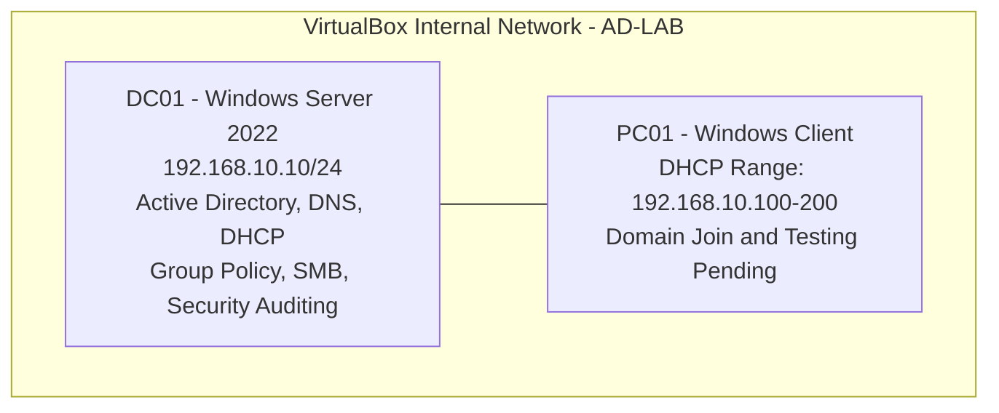


### Network Configuration

| Component | Configuration |
|---|---|
| Virtualisation platform | Oracle VirtualBox |
| Internal network | AD-LAB |
| Active Directory domain | Marcotech.ltd |
| Domain controller | DC01 |
| Server operating system | Windows Server 2022 |
| DC01 IPv4 address | 192.168.10.10 |
| Subnet mask | 255.255.255.0 |
| DNS server | 192.168.10.10 |
| DHCP scope | 192.168.10.100–192.168.10.200 |
| Client workstation | PC01 — integration pending |

### Network Design Considerations

The lab uses an isolated VirtualBox internal network to separate the simulated business infrastructure from the host's normal network.

DC01 uses a static IPv4 address to provide a consistent endpoint for Active Directory and DNS services.

The DHCP scope was configured to support automatic IP address assignment to future domain-joined workstations.

Client-side DHCP leasing, domain joining, and policy enforcement remain pending validation.

## Active Directory Organisational Structure

Active Directory Domain Services (AD DS) was deployed on Windows Server 2022 to provide centralised identity management for the fictional Marcotech Ltd organisation.

A hierarchical Organisational Unit (OU) structure was designed to organise employees, computers and security groups.

### Organisational Unit Design

```text
Marcotech.ltd
└── Company
    ├── Computers
    │   ├── Servers
    │   └── Workstations
    ├── Groups
    └── Users
        ├── Sales
        ├── HR
        ├── Finance
        ├── IT
        ├── Management
        └── Operations
```

This structure supports departmental administration, targeted Group Policy application, and logical separation of directory objects.

### Active Directory OU Configuration

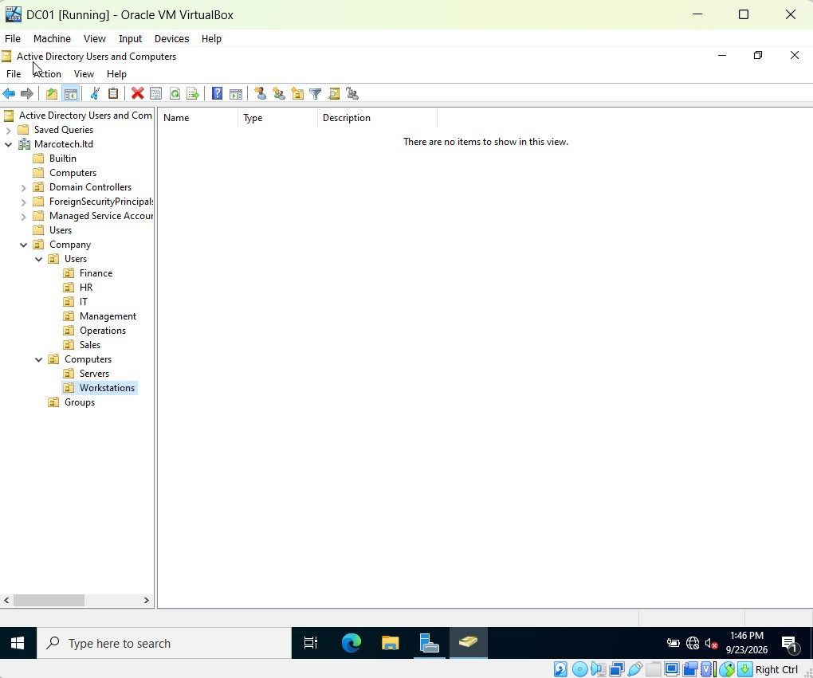

*Figure 1: Departmental OU hierarchy configured in Active Directory Users and Computers.*

## Employee Account Provisioning

The lab simulates a business with 30 employees distributed across six departments.

One user account was created manually to demonstrate the standard Active Directory account creation process. The remaining 29 accounts were provisioned using PowerShell and a CSV dataset.

The automation script imports employee information, identifies the appropriate departmental OU, creates the user account, and assigns the corresponding Active Directory security group.

### Employee Distribution

| Department | Employees | Security Group |
|---|---:|---|
| Sales | 8 | SG_Sales |
| HR | 4 | SG_HR |
| Finance | 5 | SG_Finance |
| IT | 5 | SG_IT |
| Management | 3 | SG_Management |
| Operations | 5 | SG_Operations |
| **Total** | **30** | **6 groups** |

### Verification of Employee Accounts

PowerShell was used to verify the number of employee accounts within the Company Users OU:

```powershell
(Get-ADUser -Filter * -SearchBase "OU=Users,OU=Company,DC=Marcotech,DC=ltd").Count
```

**Result:** 30 employee accounts.

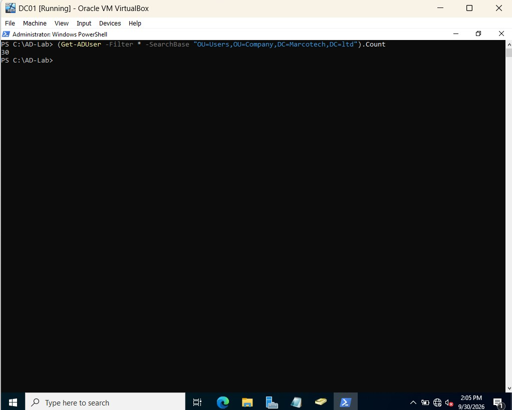

*Figure 2: PowerShell verification of the 30 employee accounts.*

### Departmental Security Groups

Six Active Directory security groups were configured to support role-based access control (RBAC).

Rather than assigning file permissions individually, departmental permissions were assigned to security groups. Employee access can therefore be managed centrally through group membership.

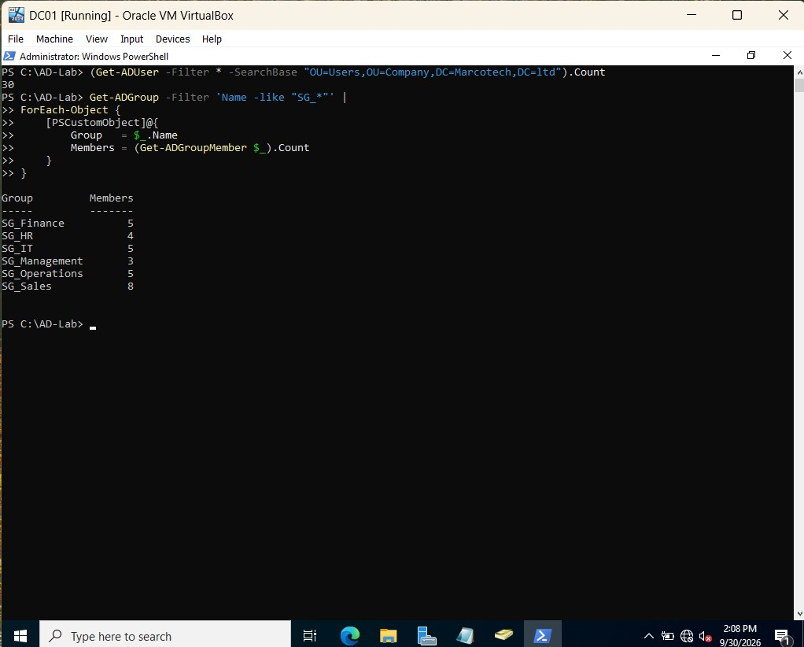

*Figure 3: PowerShell verification of departmental security group membership.*

### PowerShell Automation

The provisioning workflow demonstrates:

- CSV-based employee account creation.
- Departmental OU placement.
- Automatic security group assignment.
- Duplicate account checks.
- Secure temporary password entry.
- Mandatory password changes at first logon.
- Error handling and deployment reporting.

**Script:** [Create-ADUsers.ps1](scripts/Create-ADUsers.ps1)

**Dataset:** [employees.csv](data/employees.csv)

The GitHub script is a revised, documented version of the original lab automation. The revised version has not been independently retested on DC01.

## Departmental File Sharing and Role-Based Access Control (RBAC)

### Overview

To simulate a business file server, six departmental folders were created on DC01 using Windows Server 2022.

The objective was to implement centralised file sharing while restricting access based on employees' Active Directory security group memberships.

Two security mechanisms were configured:

- **SMB (Server Message Block):** Provides network access to shared folders and supports share-level permissions.
- **NTFS Permissions:** Control file and folder access, including reading, modifying, and deleting files.

Together, these mechanisms provide layered access control for departmental resources.

### Departmental Folder Structure

The following directory structure was created:

```text
C:\CompanyShares
├── Sales
├── HR
├── Finance
├── IT
├── Management
└── Operations
```

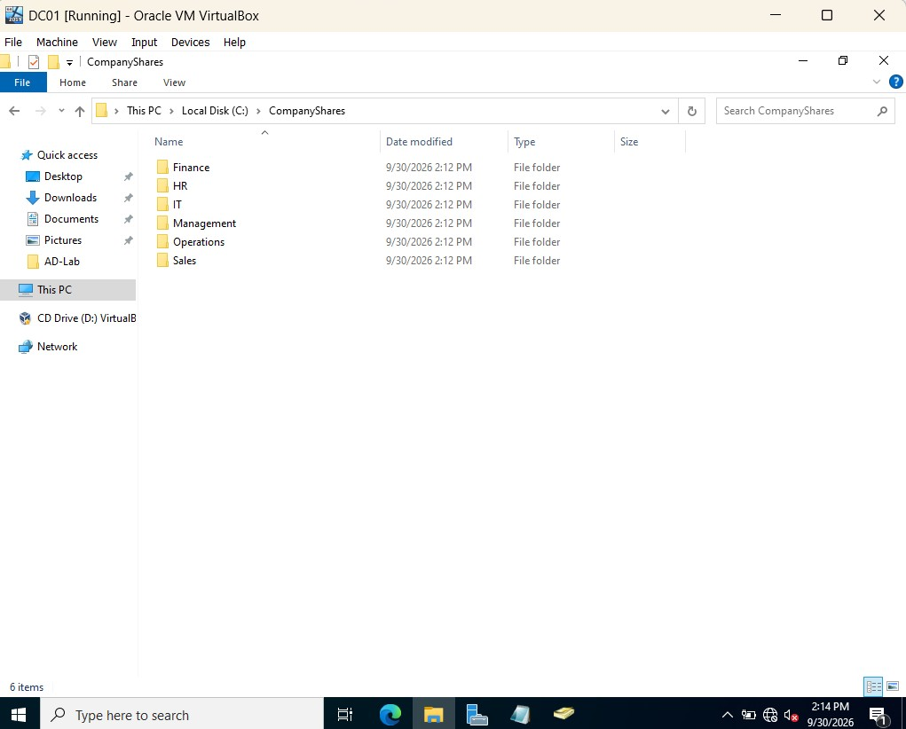

*Figure 4: Departmental folders created on DC01.*

### Security Group-Based Permissions

Each departmental folder was configured to use its corresponding Active Directory security group.

| Department | Security Group | Intended NTFS Permission | SMB Permission |
|---|---|---|---|
| Sales | SG_Sales | Modify | Change |
| HR | SG_HR | Modify | Change |
| Finance | SG_Finance | Modify | Change |
| IT | SG_IT | Modify | Change |
| Management | SG_Management | Modify | Change |
| Operations | SG_Operations | Modify | Change |

The access-control design also retains Full Control for Domain Admins and SYSTEM at the filesystem level.

This approach simplifies access management. Instead of assigning permissions to individual employees, administrators can manage departmental access through security group membership.

### NTFS Permission Configuration

NTFS permissions were configured to restrict access to departmental folders.

The Sales department was configured manually to demonstrate an understanding of Windows filesystem security before automating the remaining departments.

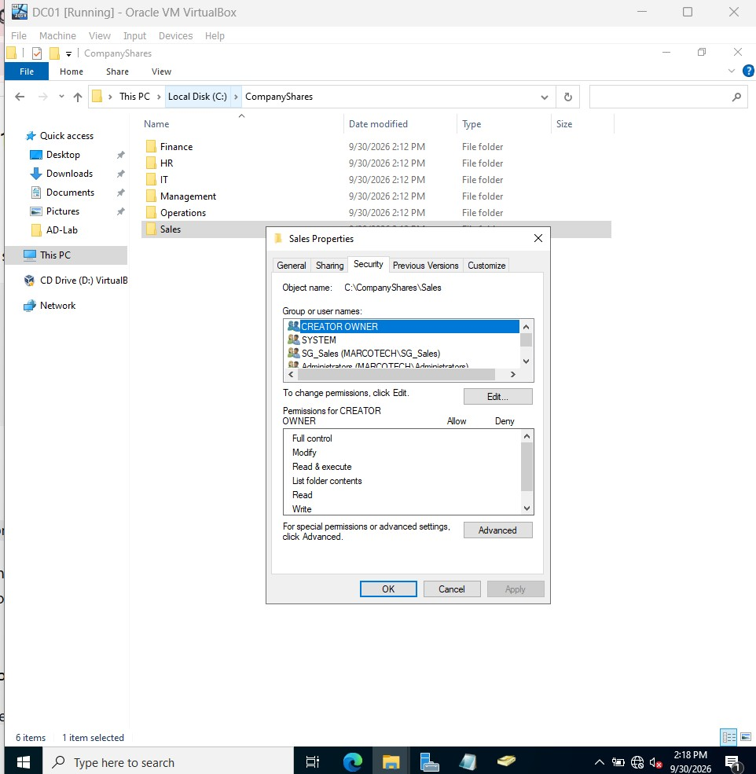

*Figure 5: Sales folder security configuration in Windows Server.*

### PowerShell Automation

A PowerShell script was developed to automate departmental folder creation, NTFS permission assignment, and SMB share configuration for HR, Finance, IT, Management, and Operations.

The automation includes:

- Departmental folder creation.
- Active Directory security group validation.
- NTFS inheritance configuration.
- Group-based filesystem permissions.
- SMB share creation.
- Error handling and deployment reporting.

**Script:** [Create-DepartmentShares.ps1](scripts/Create-DepartmentShares.ps1)

The published script is a revised portfolio version of the original automation and has not been independently retested.

Figure 6: PowerShell output from departmental file-sharing automation.

SMB Share Verification

PowerShell was used to inspect the configured network shares:

Get-SmbShare |
Where-Object Name -in @(
    "Sales",
    "HR",
    "Finance",
    "IT",
    "Management",
    "Operations"
) |
Select-Object Name, Path

The output showed six departmental SMB shares.


Figure 7: Verification of departmental SMB shares and their filesystem paths.

Planned Access-Control Validation

Client-side testing will be performed using PC01 when sufficient virtual machine resources are available.

The planned tests include:

Sign in using a Finance employee account.

Access \\DC01\Finance and verify authorised file operations.

Attempt to access \\DC01\HR.

Confirm that unauthorised access is denied.

Repeat the tests using accounts from other departments.

These tests will validate the effective SMB and NTFS permissions from a domain-joined workstation.

Status: Server-side configuration completed. End-to-end client access testing remains pending.

Security Concepts Demonstrated

Role-Based Access Control (RBAC)

Principle of Least Privilege

Active Directory security groups

SMB network file sharing

NTFS filesystem permissions

PowerShell administrative automation

Departmental resource isolation

## DNS and DHCP Configuration

### Overview

DNS and DHCP services were configured on DC01 to support the Marcotech Ltd Active Directory environment.

- **DNS (Domain Name System):** Resolves domain names to IP addresses and helps clients locate Active Directory services.
- **DHCP (Dynamic Host Configuration Protocol):** Automatically assigns network configuration to client devices.

Both services are essential components of a centrally managed Windows business network.

### 1. DNS Server Configuration

The DNS Server role was configured on DC01 as part of the Active Directory infrastructure.

The domain controller uses the following network configuration:

| Setting | Value |
|---|---|
| Domain | Marcotech.ltd |
| DNS server | DC01 |
| DNS server IP | 192.168.10.10 |
| DNS zone | Marcotech.ltd |
| Network | 192.168.10.0/24 |

Active Directory relies on DNS to locate domain controllers and other domain services using records such as A and SRV records.

**DNS Verification**

PowerShell was used to test name resolution:

```powershell
Resolve-DnsName Marcotech.ltd
```

The domain name resolved to `192.168.10.10`. The captured verification also showed an initial DNS timeout, so the result demonstrates successful resolution rather than an entirely warning-free DNS test.

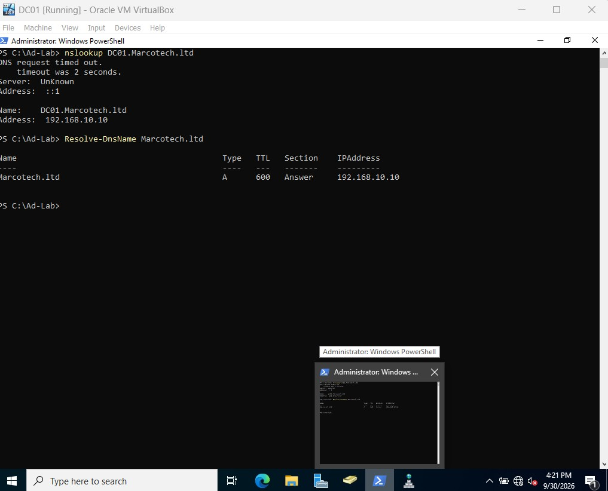

*Figure 8: DNS name resolution verification on DC01.*

### 2. DHCP Server Configuration

The DHCP Server role was installed and a scope was configured to provide automatic IP address allocation to future client workstations.

**DHCP Scope Configuration**

| Setting | Value |
|---|---|
| DHCP server | DC01 |
| Scope network | 192.168.10.0/24 |
| Start IP address | 192.168.10.100 |
| End IP address | 192.168.10.200 |
| Subnet mask | 255.255.255.0 |
| DNS server option (006) | 192.168.10.10 |
| DNS domain option (015) | Marcotech.ltd |
| Default gateway | Not configured — isolated lab |

The DHCP scope reserves lower addresses outside the dynamic allocation range for infrastructure and potential future static assignments.

**DHCP Role Installation**

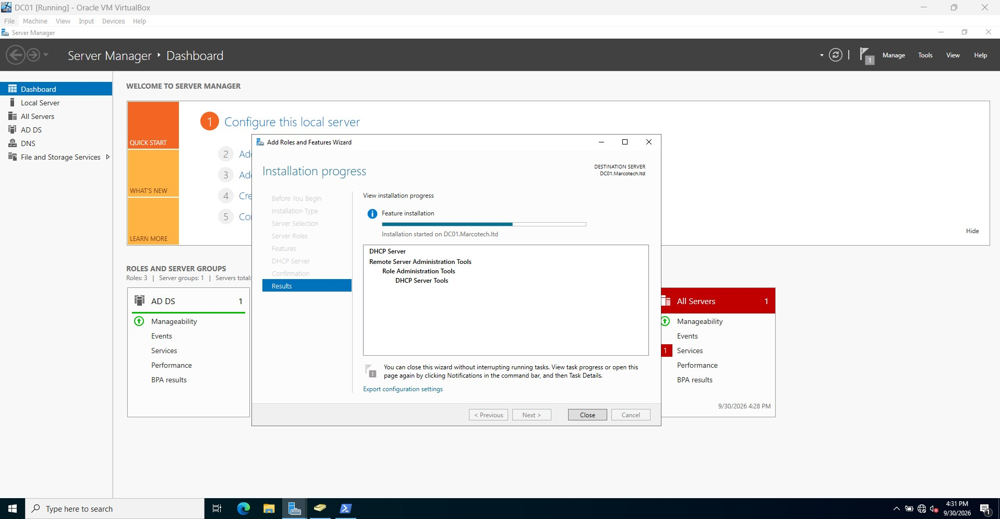

*Figure 9: Installation of the DHCP Server role.*

**DHCP Address Pool**

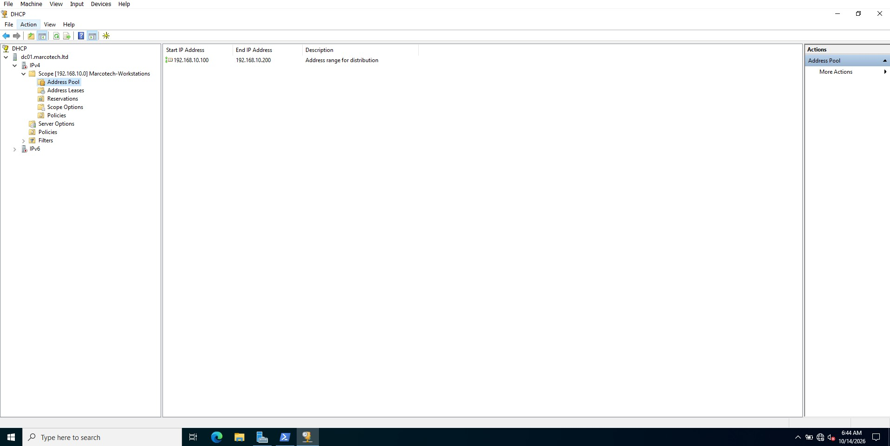

*Figure 10: DHCP address pool configuration.*

### 3. DHCP Scope Verification

PowerShell was used to inspect the configured DHCP scope:

```powershell
Get-DhcpServerv4Scope
```

The scope was reported as active.

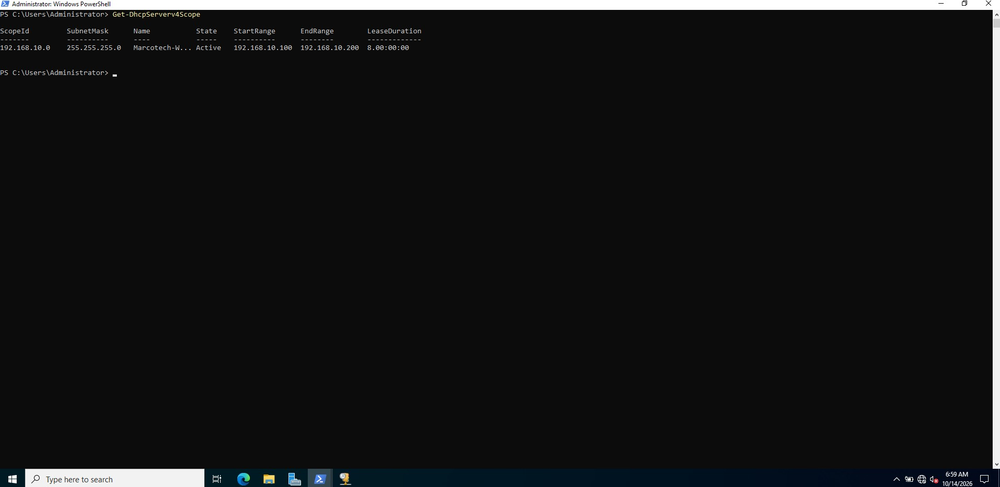

*Figure 11: PowerShell verification of the DHCP scope.*

### 4. Planned Client-Side Validation

The following tests are planned for PC01:

1. Configure the network adapter to obtain an IP address automatically.
2. Confirm that the workstation receives an address between `192.168.10.100` and `192.168.10.200`.
3. Verify the assigned DNS server using `ipconfig /all`.
4. Test domain name resolution using `nslookup`.
5. Confirm that DNS can locate Active Directory domain services.

These tests will verify that the DHCP and DNS configurations work correctly from a client workstation.

**Status:** Server-side DNS and DHCP configuration completed. Client-side DHCP leasing and domain integration remain pending.

### Networking Skills Demonstrated

- Static IPv4 addressing
- DNS server administration
- Active Directory DNS integration
- DNS name resolution troubleshooting
- DHCP scope configuration
- DHCP options 006 and 015
- Windows PowerShell network administration
- VirtualBox isolated network configuration

- ## Group Policy and Windows Security Hardening

### Overview

Group Policy was used to configure centralised security settings within the Marcotech Ltd Active Directory domain.

The objective was to demonstrate how organisations can enforce security controls, restrict user access to administrative settings, and reduce risks associated with unauthorised access and password-based attacks.

### 1. Department-Specific Group Policy

A Group Policy Object (GPO) named `GPO_Sales_Restrict_ControlPanel` was created and linked to the Sales Organisational Unit.

**Configuration:**

| Setting | Value |
|---|---|
| GPO name | GPO_Sales_Restrict_ControlPanel |
| Linked OU | Company → Users → Sales |
| Configuration type | User Configuration |
| Policy location | Administrative Templates → Control Panel |
| Policy | Prohibit access to Control Panel and PC settings |
| Intended setting | Enabled |

This policy is designed to prevent Sales employees from accessing Control Panel and Windows Settings.

Restricting access to these interfaces helps limit unnecessary configuration changes by standard users.

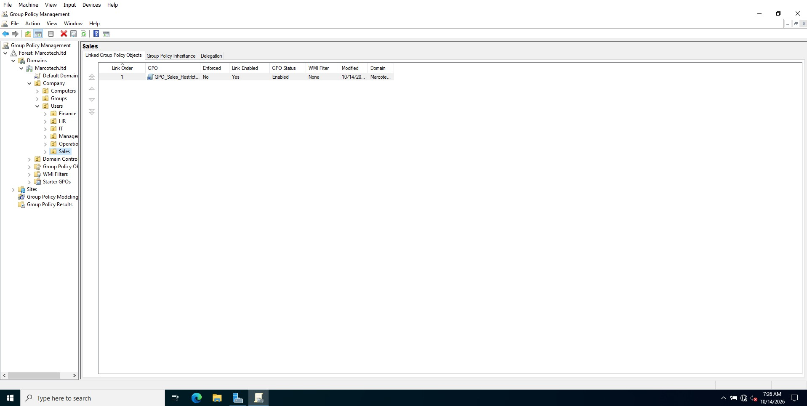

*Figure 12: Sales Group Policy Object linked to the departmental OU.*

**Validation status:** The GPO was configured on DC01. Enforcement on a domain-joined Sales workstation has not yet been tested.

### 2. Account Lockout Policy

An account lockout policy was configured through the Default Domain Policy to limit repeated failed authentication attempts.

**Configured settings:**

| Security setting | Value |
|---|---|
| Account lockout threshold | 5 invalid logon attempts |
| Account lockout duration | 15 minutes |
| Reset account lockout counter after | 15 minutes |

This configuration helps reduce the risk of repeated password-guessing attempts against Active Directory accounts.

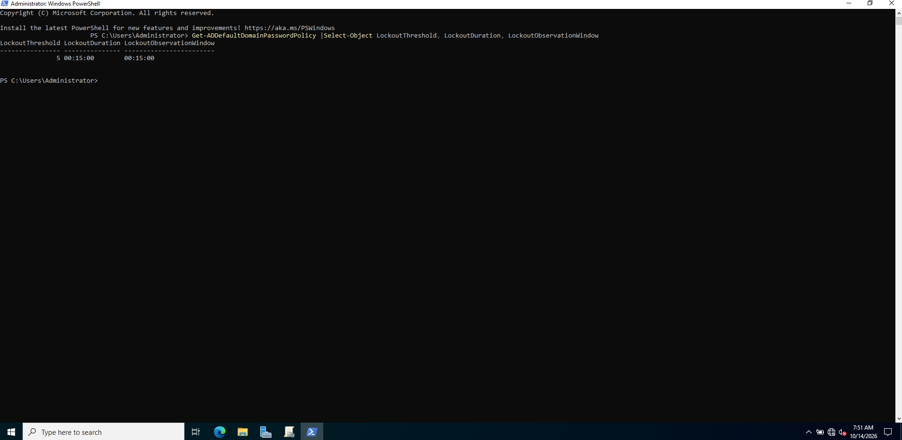

*Figure 13: Domain account lockout configuration.*

### 3. Domain Password Security Policy

Password security settings were managed centrally through the Default Domain Policy.

The lab included configuration of password complexity, minimum password length, password history, and account password management.

The original security-hardening target was:

| Security setting | Target configuration |
|---|---|
| Minimum password length | 14 characters |
| Password complexity | Enabled |
| Password history | 10 passwords |
| Minimum password age | 1 day |
| Maximum password age | 0 days (no expiry) |
| Reversible encryption | Disabled |

**Verification note:** A captured PowerShell verification screenshot showed a minimum password length of 7 characters and a password history of 24, which differed from the intended settings. The values above therefore represent the hardening target, not a fully verified final configuration.

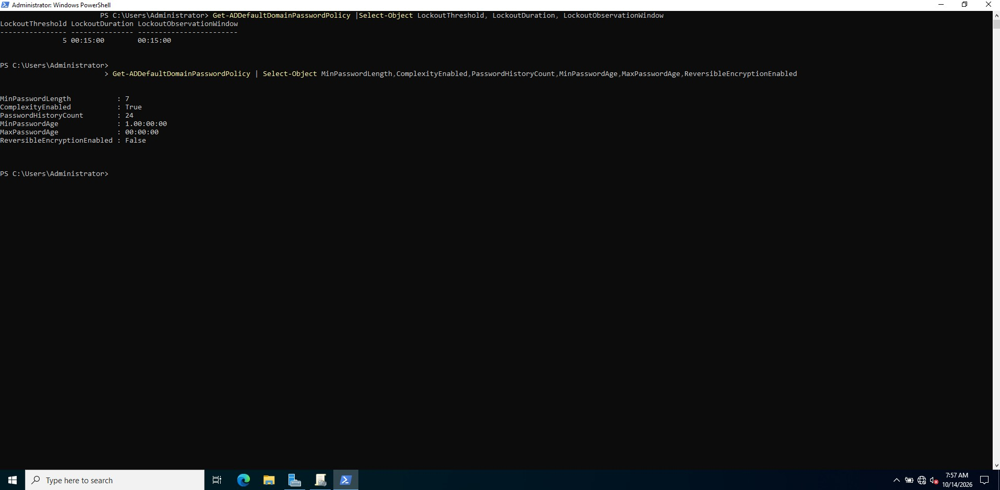

*Figure 14: PowerShell inspection of Active Directory domain password policy settings.*

### 4. Security Principles Demonstrated

The security configuration illustrates several fundamental cybersecurity concepts:

- **Centralised policy management:** Security settings are administered through Active Directory Group Policy.
- **Access restriction:** Department-specific policies can limit access to system configuration interfaces.
- **Password security:** Complexity and length requirements help strengthen account authentication.
- **Account lockout:** Repeated authentication failures can trigger temporary account lockouts.
- **Defence in depth:** Multiple controls work together to reduce security risks.
- **Security verification:** PowerShell and Group Policy tools can be used to inspect configured settings.

### 5. Planned Client-Side Validation

Future testing on PC01 will include:

1. Joining the workstation to the `Marcotech.ltd` domain.
2. Signing in using a Sales employee account.
3. Running `gpupdate /force` to refresh Group Policy.
4. Using `gpresult /r` to verify applied policies.
5. Attempting to open Control Panel and confirming that the restriction is enforced.

**Status:** Group Policy configuration completed on DC01. Client-side enforcement testing remains pending.

## Windows Security Auditing and Event Log Analysis

### Overview

Windows Security Auditing was configured on DC01 to monitor authentication activity and security-relevant events within the Marcotech Active Directory environment.

The objective was to gain practical experience with Windows event logging, authentication monitoring, and security investigation techniques commonly used by IT administrators and Security Operations Centre (SOC) analysts.

### 1. Advanced Audit Policy Configuration

A Group Policy Object named `GPO_DC_Security_Auditing` was created and linked to the Domain Controllers OU.

Advanced Audit Policy settings were configured to monitor security-related activity, including:

- Kerberos authentication activity.
- Credential validation.
- User account management.
- Security group management.
- Successful and failed logon attempts.
- Account lockout activity.

The auditing configuration was applied using:

```powershell
gpupdate /force
```

The configured auditing settings were inspected using:

```powershell
auditpol /get /category:*
```

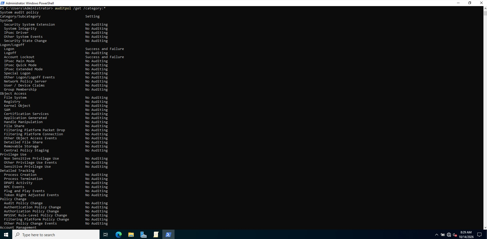

*Figure 15: PowerShell output showing Windows Security Auditing settings on DC01.*

The screenshot provides evidence of selected auditing subcategories, including Logon and Account Lockout. It does not independently verify every configured audit category.

### 2. Windows Event Viewer Investigation

Windows Event Viewer was used to inspect authentication-related events generated by the domain controller.

**Tool:** Event Viewer → Windows Logs → Security

Several Windows Security Event IDs are useful for authentication monitoring:

| Event ID | Description | Security relevance |
|---|---|---|
| 4624 | Successful logon | Identify successful sign-ins |
| 4625 | Failed logon | Investigate unsuccessful authentication |
| 4740 | User account locked out | Identify account lockout activity |
| 4768 | Kerberos authentication ticket requested | Monitor Kerberos authentication |
| 4771 | Kerberos pre-authentication failed | Investigate authentication failures |
| 4776 | Credential validation | Monitor NTLM credential validation |

### 3. Authentication Event Analysis

An authentication-related security event was inspected using Windows Event Viewer.

**Observed event details:**

| Field | Value |
|---|---|
| Event ID | 4776 |
| Event source | Microsoft-Windows-Security-Auditing |
| Account | Administrator |
| Source workstation | DC01 |
| Authentication result | Success |
| Error code | 0x0 |

Event ID 4776 indicates that Windows attempted to validate credentials using NTLM authentication.

The recorded error code `0x0` indicates successful credential validation.

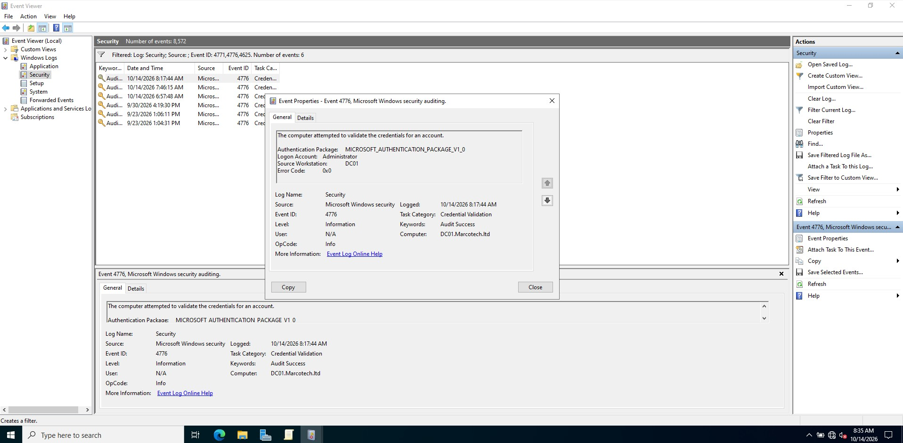

*Figure 16: Windows Event Viewer showing a successful credential validation event (Event ID 4776).*

### 4. Security Investigation Workflow

The investigation followed a basic Windows security monitoring workflow:

1. Configure auditing through Group Policy.
2. Apply the policy to the domain controller.
3. Inspect the effective audit settings using PowerShell.
4. Open Windows Event Viewer and filter relevant Security Event IDs.
5. Examine event details such as account name, source workstation, timestamp, and authentication status.
6. Interpret the event to determine the authentication outcome.

This workflow demonstrates foundational skills relevant to security monitoring, incident investigation, and Windows log analysis.

### 5. Security Skills Demonstrated

- Windows Advanced Audit Policy configuration.
- Group Policy-based security monitoring.
- Windows Security Event Log analysis.
- Authentication event identification.
- Understanding of Kerberos and NTLM authentication events.
- PowerShell security auditing verification.
- Foundational SOC investigation techniques.

**Validation status:** Audit configuration and inspection of a successful credential-validation event were completed on DC01. The supplied screenshot does not demonstrate a failed authentication event or a completed account-lockout investigation.

## Troubleshooting and Lessons Learned

### Overview

During the development of the Marcotech Active Directory lab, several technical challenges provided opportunities to practise troubleshooting, system administration, and infrastructure planning.

The following sections document the main challenges encountered and the approaches taken.

### 1. Virtual Machine Resource Limitations

**Challenge:** The host laptop had insufficient available resources to run the Windows Server domain controller (DC01) and Windows client workstation (PC01) simultaneously with acceptable performance.

**Approach:**
- Prioritised server-side configuration and verification.
- Completed Active Directory, DNS, DHCP, Group Policy, file-sharing, and auditing tasks on DC01.
- Deferred client-side integration and validation until sufficient resources become available.

**Lesson learned:** Infrastructure planning must account for available hardware resources. Testing should be organised around realistic system constraints rather than treating unperformed tests as successful.

### 2. DHCP Scope Configuration

**Challenge:** The DHCP management console initially presented a disabled or unavailable option for creating a new scope.

**Approach:**
- Reviewed the DHCP Server role and management console configuration.
- Continued troubleshooting the server configuration.
- Subsequently configured and activated the DHCP scope.
- Used PowerShell to inspect the resulting scope configuration.

**Lesson learned:** Windows Server administration often requires checking service configuration and verifying the result independently using PowerShell.

### 3. DNS Resolution Verification

**Challenge:** A DNS verification command displayed an initial timeout before successfully resolving the domain name.

**Observed result:** `Marcotech.ltd` resolved to `192.168.10.10`.

**Approach:**
- Inspected DNS resolution output.
- Confirmed that the domain resolved to the intended domain controller IP address.
- Retained the timeout as an observation requiring further investigation rather than claiming the test was entirely error-free.

**Lesson learned:** Successful name resolution does not automatically mean every DNS operation is healthy. DNS timeouts, server responsiveness, and Active Directory service records should also be investigated.

### 4. Group Policy and Security Verification

**Challenge:** Security settings configured through Group Policy require verification to establish which settings are actually effective.

**Approach:**
- Used Group Policy Management to configure domain and departmental policies.
- Used `gpupdate /force` and PowerShell commands to inspect server-side policy settings.
- Identified a discrepancy between the intended password policy and the values shown in a captured verification screenshot.

**Lesson learned:** A configured policy and an effective policy are not always identical. Administrators should verify the applied configuration before reporting a security control as successfully enforced.

### 5. PowerShell Automation Improvements

The initial automation scripts were developed to provision employee accounts and configure departmental file shares.

For the public GitHub repository, revised versions were prepared with improvements such as:

- Relative CSV paths for portability.
- More explicit error handling.
- Security group existence checks.
- Duplicate account and group membership checks.
- Safeguards against unexpected changes to existing folders.
- Clearer documentation and deployment output.

The revised portfolio scripts have not been independently retested on DC01.

**Lesson learned:** Automation should be designed for maintainability, predictable behaviour, and safe handling of existing infrastructure.

---

## Project Limitations

The following limitations apply to the current version of the lab:

| Area | Current status |
|---|---|
| DC01 domain controller | Configured |
| Active Directory users and groups | Created and verified |
| DNS and DHCP | Server-side configuration completed |
| Departmental SMB shares | Created and inspected |
| Group Policy | Configured on DC01 |
| Security auditing | Configured and selected events inspected |
| PC01 domain join | Pending |
| PC01 DHCP lease verification | Pending |
| Sales GPO enforcement on PC01 | Pending |
| Departmental access-denied testing | Pending |
| Revised PowerShell script testing | Pending |

The project demonstrates server-side Windows infrastructure administration and foundational cybersecurity controls. End-to-end client validation remains a future enhancement.

---

## Future Improvements

### Phase 1 — Client Workstation Integration

- Optimise the VirtualBox virtual machines to reduce resource consumption.
- Start DC01 and PC01 simultaneously.
- Join PC01 to the `Marcotech.ltd` domain.
- Verify client-side DNS resolution and DHCP assignment.
- Authenticate using departmental Active Directory accounts.

### Phase 2 — Security Policy Validation

- Verify Sales Group Policy enforcement on PC01.
- Test authorised and unauthorised access to departmental SMB shares.
- Validate effective NTFS and SMB permissions.
- Confirm password and account lockout policy behaviour using controlled tests.

### Phase 3 — Advanced Security Monitoring

- Generate controlled failed-authentication events.
- Investigate Windows Security Event IDs 4625, 4771, and 4740 where applicable.
- Explore Windows Event Forwarding or a SIEM platform for centralised security monitoring.
- Develop PowerShell scripts to report on inactive accounts, group memberships, and security events.

### Phase 4 — Infrastructure Expansion

- Add additional Windows client workstations.
- Introduce a dedicated member file server rather than hosting departmental shares on the domain controller.
- Explore Active Directory backup and recovery procedures.
- Investigate Windows Server hardening and security baselines.

---

## Key Skills Developed

This project provided hands-on experience with:

- Windows Server 2022 administration.
- Active Directory Domain Services.
- Organisational Unit and security group management.
- PowerShell automation and CSV-based provisioning.
- DNS and DHCP configuration.
- Group Policy administration.
- SMB file sharing and NTFS permissions.
- Role-Based Access Control (RBAC).
- Windows Security Auditing and Event Viewer.
- Infrastructure troubleshooting and technical documentation.
